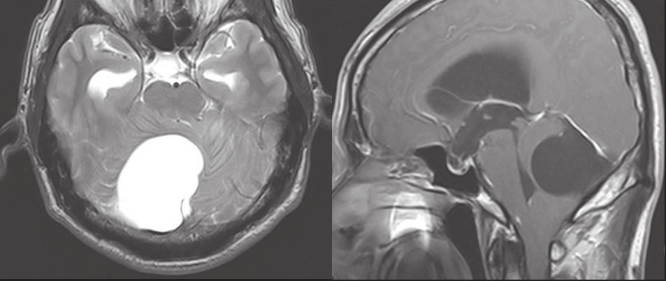

# 신경낭미충증 2

## 증례

52세 여자가 4개월 동안 점점 심해지는 후두부 두통, 구역, 보행 시 비틀거림으로 내원하였다. 신경학적 진찰에서 우측 운동실조(ataxia)와 양측 유두부종(papilledema)이 있었다. 뇌 자기공명영상(MRI)에서 그림과 같은 소견이 관찰되었다.

그림 1. 뇌 MRI T2 강조 축상 영상(왼쪽)과 T1 강조 시상 영상(오른쪽)

혈청 효소면역측정법(ELISA)에서 낭미충 항체가 양성이어서 거대 신경낭미충증(giant neurocysticercosis)으로 진단되었다.

## 질문

이 환자에서 뇌실이 확장된 기전은?

## 답가지

1. 거미막과립 흡수 장애(impaired arachnoid granulation absorption)
2. 뇌실 주위 뇌 위축(periventricular brain atrophy)
3. 맥락얼기 생성 증가(choroid plexus overproduction)
4. 상시상정맥동 혈전(superior sagittal sinus thrombosis)
5. 제4뇌실 유출로 폐쇄(fourth ventricle outflow obstruction)

## 정답과 근거

**정답:** 5번

**해설:** 그림에서 후두와(posterior fossa)의 큰 낭종이 소뇌와 뇌간을 밀어 제4뇌실을 압박하고 있으며, 그 위쪽의 측뇌실과 측두각은 확장되어 있다. 뇌척수액이 제4뇌실에서 빠져나가지 못해 생긴 폐쇄성 수두증(obstructive hydrocephalus)이고, 유두부종은 이로 인한 두개내압 상승을 반영한다.

- **1번:** 거미막과립 흡수 장애는 교통성 수두증(communicating hydrocephalus)의 기전으로, 이 경우 제4뇌실을 포함한 모든 뇌실이 확장되며 후두와 종괴는 보이지 않는다.
- **2번:** 뇌 위축에 따른 뇌실 확장(hydrocephalus ex vacuo)은 뇌실질 소실에 따른 이차 변화로, 두개내압 상승이나 유두부종을 일으키지 않는다.

**근거:**

- 제시 자료: "The cyst was sharply delineated from the cerebellum and compressed the fourth ventricle, resulting in ventricular dilatation (i.e., obstructive hydrocephalus)." (Lee 2026, Case Report, p. 191)
- 참고문헌: White AC Jr, Coyle CM, Rajshekhar V, et al. Diagnosis and treatment of neurocysticercosis: 2017 clinical practice guidelines by the Infectious Diseases Society of America (IDSA) and the American Society of Tropical Medicine and Hygiene (ASTMH). Clin Infect Dis 2018;66:e49-e75.
- 그림 출처: Lee 2026, Fig. 1C–D, CC BY-NC 4.0

## 문항분류

- 기생충명 또는 주제: 유구조충(*Taenia solium*), 신경낭미충증(neurocysticercosis)
- 문항 수준: 판단형
- 학습목표: 후두와 낭종 환자의 영상 소견에서 폐쇄성 수두증의 발생 기전을 설명할 수 있다.
- 예상 난이도: 보통
- 출제 방식: 논문(Lee 2026)
- 논문 의존도: 정설(established)

## Physician task 분류

- Physician task: 병태생리·기전(mechanisms of disease)
- 분류 근거: 영상 소견을 해석하여 뇌실 확장의 발생 기전을 설명하게 한다.

## 품질 점검

- 답가지를 가리고도 답할 수 있는가(cover-the-options rule): 통과
- 추측 단서(testwiseness flaws): 없음
- 내용과 무관한 난이도(irrelevant-difficulty flaws): 없음
- 내용 점검: 통과
- 그림 점검(답 노출 표지·개인 식별 정보 없음, 출처 기재): 통과
